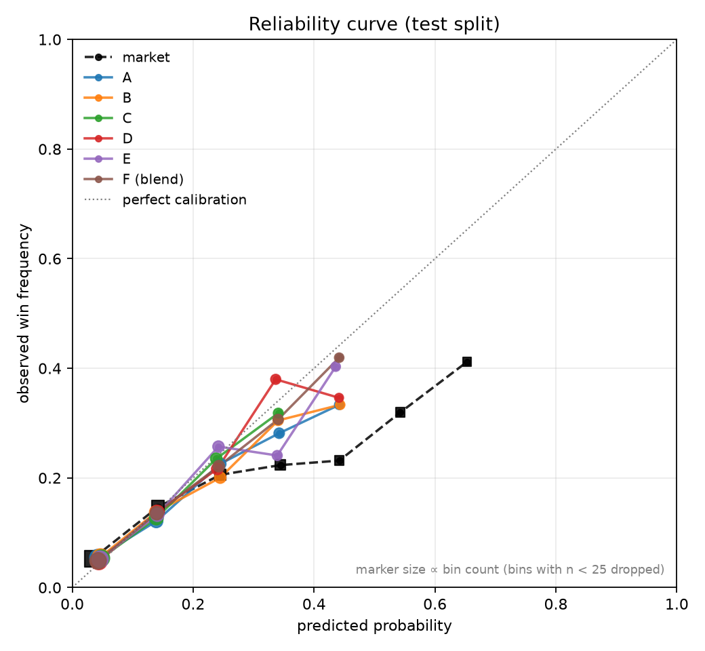
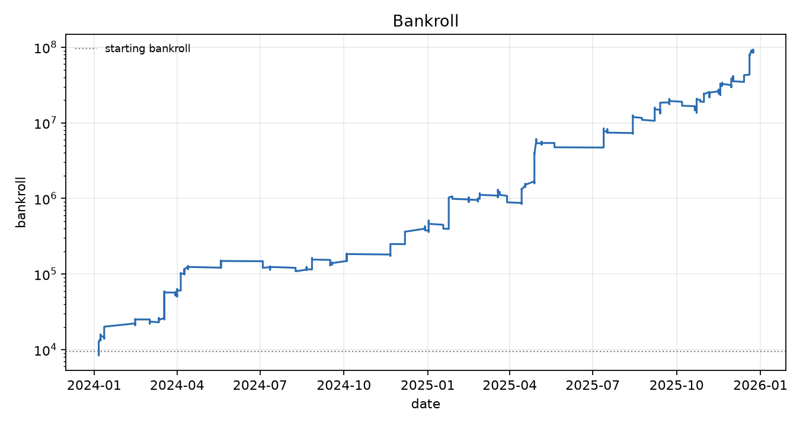
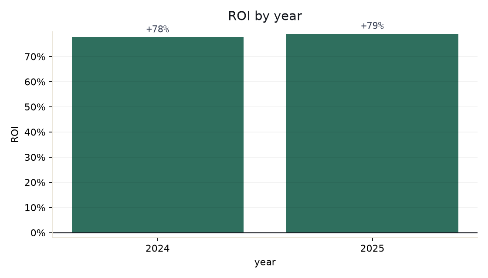

# NN-based-Horse-Racing-Prediction-HKJC

**Does a neural network beat Benter's approach on Hong Kong horse racing?**

This repository is the experimental harness for that question. It implements the
Benter pipeline faithfully — a conditional logit over pre-race fundamentals,
fused with the market's own implied probabilities — and then puts a family of
neural networks on the same footing: the same features, the same time-based
split, the same loss, the same evaluation, the same betting simulation.

The point is not to build a pretty model. The point is to answer the question
*honestly*, and to make it possible to answer it even when the answer is
"no".

> **The answer, on 6 262 real HKJC races (2018–2025): no.**
>
> Every model built on public pre-race fundamentals — conditional logit,
> LightGBM, and the neural networks — is about **8% worse in log-loss than
> the de-vigged market**. The neural network is not better than the logit;
> it is only better *calibrated*. The Benter fusion learns by itself to put
> **88% of its weight on the market** and beats the market by **+0.45%**,
> and betting it **loses 39%** after the takeout.
>
> The harness proves it rather than assuming it: with an optimal market
> configured (the **null test**) every model loses and the simulation shows
> a negative ROI. A project run with a leaky backtest would have told you
> the opposite — and would have cost you money.
>
> What is missing is not model capacity. It is **information**: odds
> movement, the order book, trackwork, veterinary records. HKJC does not
> publish those for past races, and the [feature coverage
> audit](#feature-coverage--is-it-complete) says exactly which ones and why.

---

## Visual walkthrough

`docs/research-flow.html` is a self-contained page that walks through the whole
research flow — the question, the pipeline, the A–F matrix, the leakage
guards, the null test, the results on real data, and the feature-coverage
audit. Open it in a browser; it needs no server.

---

## The research question, stated properly

Benter's framework is not "pick the winner". It is:

> Estimate a probability for each runner from fundamental information, fuse it
> with the market's probability, and bet where the fused probability beats the
> price.

That reframing is the whole game, and it dictates how the experiment must be
run:

| Question | Metric | Why not something else |
|---|---|---|
| Is the model well-calibrated? | **Log-loss**, then the reliability curve | Hit rate rewards luck; log-loss rewards honesty |
| Does it know more than the market? | **Incremental log-loss vs the de-vigged market**, reported as Benter's `R²` | A model can beat the market on log-loss and still lose money |
| Is it worth betting? | **Simulated ROI after the takeout**, at bet-time odds, with fractional Kelly | Win rate says nothing about value |
| Is the edge real or a statistical artefact? | **The null test** (§ *The null test*) | A backtest that always shows profit is a backtest that is broken |

Hit rate and top-N accuracy are computed and reported, but only as auxiliary
diagnostics. A model can pick the winner 35% of the time and still lose money,
because favourites pay little.

---

## Architecture

```
raw CSV / synthetic world
        │
        ▼
  canonical frame  ──── one row per runner per race, every column timestamped
        │
        ▼
  causal features  ──── history computed over STRICTLY PRIOR DATES only
        │
        ├──► tabular branch ─────────────────────────────────┐
        └──► text branch (TF-IDF + SVD, 12 dims) ────────────┤
                                                            ▼
                                            per-race softmax probability
                                                            │
                        ┌───────────────────────────────────┤
                        ▼                                   ▼
              A. conditional logit            B. LightGBM     C/D. NN
              (McFadden, L2)                   (binary +       (listwise MLP /
                                                 calibrated)    field transformer)
                        └───────────────────────────────────┘
                                                            ▼
                                            market layer (model F)
                              c_i = softmax(α·log f_i + β·log π_i)
                                                            ▼
                                        betting simulation (Kelly, takeout)
```

### Layout

```
src/hkjc_nn/
  schema.py               canonical column contract, de-vigging (basic + Shin)
  data/
    synthetic.py          the simulator: a lab bench with a known ground truth
    csv_adapter.py        real HKJC extracts → canonical frame (alias-tolerant)
  collect/
    hkjc.py               the collector: results, horse pages, veterinary records
  features.py             causal feature construction; the leakage guards live here
  text.py                 text branch: TF-IDF + SVD, swappable for a real encoder
  models/
    conditional_logit.py  model A — analytic gradients, L-BFGS-B
    lightgbm_model.py     model B — binary win target + calibrated softmax
    neural.py              models C/D — listwise MLP and field-attention transformer
    market.py             model F — the Benter power blend
  evaluation.py           log-loss, reliability curves, R² vs the market
  betting.py              fractional Kelly, payout models, EV diagnostics
  splits.py               time-based splitting
  coverage.py             the feature-coverage audit against the specification
  plots.py                reliability curves, equity curve, yearly ROI
  experiments.py          the A–F runner
  cli.py                  `hkjc-nn make-data | run | collect | coverage | describe`
```

---

## Quick start

```powershell
python -m venv .venv
.\.venv\Scripts\python -m pip install -e ".[dev,torch]"

# Collect real HKJC races (6 000+ races, ~40 min, cached on disk)
.\.venv\Scripts\hkjc-nn collect --start 2018-01-01 --end 2025-12-31 --target-races 7000 `
                                --out data\hkjc_races.csv --delay 0.2 --workers 10

# Run the whole matrix on them
.\.venv\Scripts\hkjc-nn run --data data\hkjc_races.csv --train-until 2022-12-31 --val-until 2023-12-31

# Or run the whole matrix on simulated data (no files needed)
.\.venv\Scripts\hkjc-nn run --synthetic --races 2500 --metrics-out metrics.csv --plot-dir figures

# Audit which features the specification actually covers
.\.venv\Scripts\hkjc-nn coverage --data data\hkjc_races.csv
```

`hkjc-nn make-data --out data/synthetic.csv` writes a canonical dataset you can
inspect; `hkjc-nn describe path/to.csv` tells you which canonical columns a
real extract can populate, and which ones it cannot.

---

## The experiment matrix

| Code | Model | Purpose |
|---|---|---|
| A | Conditional logit (tabular) | The floor. Already outputs calibrated, race-normalised probabilities. |
| B | LightGBM (tabular) | The strong tree baseline. |
| C | NN (tabular) | Does deep learning help at all? |
| D | NN (tabular + text) | Is the text worth anything? |
| E | LightGBM (tabular + text) | The fair control for D. |
| F | Best of A–E + market odds | Can anything beat the market? |

**D versus E is the decisive comparison in the neural-network story.** If D does
not clearly beat E, the extra architecture is not justified and the project
should have stopped at the tree model.

**F is answered with money, not accuracy.** Model selection for F uses the
*validation* split only; the test split is touched once, at the end.

### Two architectures, because they are not the same experiment

- **`ListwiseMLP`** encodes each runner independently. It keeps the conditional
  logit's *fixed-utility* assumption, so it is the apples-to-apples comparison:
  same information, same loss, different function class.
- **`FieldTransformer`** runs self-attention over the runners *within* each
  race. This is the architecture with a real shot at winning, because a
  conditional logit is a fixed-utility model — runner *i*'s score cannot depend
  on who else is running. "This horse is the strongest in this field" is
  exactly the signal a logit cannot express and an attention layer can.

Both are trained with the listwise softmax loss, so all three model families
optimise the identical objective.

---

## Two decisions that materially change the numbers

**1. De-vigging.** The market probability `π` comes from removing the margin
from the published odds. *Proportional* de-vig is the default, and it is the
right choice for HKJC: the pool **is** the market, so the pool-implied prices
are precisely what you have to beat. Shin's method additionally corrects for
favourite-longshot bias, which is the right choice for a fixed-odds bookmaker
quoting a behaviourally biased market — applied to a pari-mutuel pool it
*over*-corrects, pushing probability mass towards favourites. Pass
`--devig shin` to compare.

**2. Turning tree scores into probabilities.** LightGBM's `lambdarank`
objective produces ranking scores, not probabilities, and a binary classifier
trained on `won == 1` produces per-runner probabilities that do not sum to one
within a race. Simply dividing by the race total is wrong in a specific and
damaging way: the raw probabilities are already attenuated, so normalising
them makes the distribution *too flat* — favourites under-priced, longshots
over-priced — which is exactly the mis-calibration that makes a betting rule
chase 50-1 shots. The default here takes the **logit** of the raw score and
applies a per-race softmax with a temperature fitted on the validation split.

---

## Leakage control

This is where racing projects usually die, so it is enforced in code rather than
by convention.

**Every historical feature uses strictly prior dates.** For a race on date *d*,
only races with `meeting_date < d` contribute. Races on the *same* day are
excluded even though the earlier ones would technically have finished — being
conservative costs a little signal and removes a whole class of subtle leakage.

**Post-race information is dropped by construction.** Outcome columns are never
features. Free-text columns carry their own timestamp, and any text published
after the race start is scrubbed. Without a race start time, text is refused
entirely rather than used on trust.

**Imputation statistics come from the training split only.** Filling missing
values with a median computed over the whole dataset makes every feature depend
on the whole dataset — appending new races then changes the features of older
races. The same applies to the shrinkage base rate used by the historical rates.

**A feature that is only knowable *today* is not a pre-race feature.** HKJC
publishes a horse's age as of the collection date, so for a 2018 race that
column holds the horse's age in 2026. The feature builder excludes it, and the
pre-race version is derived instead. This one was not caught by inspection — it
was caught by an ablation, after it had already cost the conditional logit
0.20 nats of test log-loss. See *A leakage the audit caught*.

**Availability shifts are reported.** A feature populated for 10% of the
training rows and 36% of the test rows is a train/serve shift, not merely
missing data: the model learns its coefficient from one population and applies
it to another. The runner prints the train-vs-test coverage of every feature
and flags the ones that move.

The test suite pins all of this down with an **append-only causality test**:
build the features from the races up to some date, append more races, rebuild,
and require every earlier feature to be bit-for-bit identical.

---

## The null test

The single most important check in the project. The simulator's market is
configurable, and can be made **optimal**:

```powershell
hkjc-nn run --synthetic --market-skill 1 --market-specialist 1 --market-condition 1 --market-noise 0 ...
```

With an optimal market, no model can find edge — there is nothing to find. A
pipeline that shows a positive ROI in that configuration is *manufacturing*
profit, and every other number it produces is worthless.

This is enforced as a test (`test_null_market_produces_no_profit`). Measured on
the current configuration, the null case gives every model a **negative** R²
(−0.085 to −0.112 against the market), the blend +0.001, and a betting ROI of
**−3.5%** on staked capital — which is the result you want.

The `market_noise` knob also shows how fast the ROI tracks the market's
inefficiency — and therefore how little it is worth on its own:

| `market_noise` | F's R² vs market | ROI on staked | `ev_ratio` |
|---|---|---|---|
| 0 (optimal market) | +0.001 | **−3.5%** | −0.27 |
| 0.55 (default) | +0.050 | +79% | 1.09 |
| 0.75 | +0.082 | +126% | 1.23 |

Every one of those ROIs is a dial setting, not a discovery. The `0` row is the
one that matters: the whole ROI column collapses to a loss when the market has
nothing to hide, which is what a trustworthy harness has to do.

---

## The simulator

Real HKJC data is licensed, slow to collect, and slow to iterate on. The
simulator is the **lab bench**: a world with a known ground truth whose
parameters describe how efficient the market is.

The truth is built from three layers, each with a different visibility:

| Layer | What it is | Who can see it |
|---|---|---|
| visible | ability, form, jockey, trainer | the market (noisy) **and** the model |
| specialist | distance and going affinity | mostly the market; the model finds it in history |
| condition | fitness on the day | the market is blind; it leaks through the pre-race notes |

The split is what gives the project an edge to find at all — and it is why the
text branch is worth having.

The knobs:

| Parameter | Effect |
|---|---|
| `market_noise` | The market's own information noise. **0 = a market that cannot be beaten.** |
| `market_skill` | How much of the visible layer the market prices in. |
| `market_specialist` | How much of the specialist layer the market prices in. |
| `market_condition` | How much of the condition layer the market prices in. `0` leaves the notes as the only channel. |
| `signal_noise` | How noisy the pre-race features are. This is the accuracy ceiling for *every* model. |
| `takeout` | The bookmaker margin baked into the published odds. |

```powershell
# Null case: an optimal market
hkjc-nn run --synthetic --market-skill 1 --market-specialist 1 --market-condition 1 --market-noise 0

# Default: a beatable but realistic market
hkjc-nn run --synthetic --market-noise 0.55
```

---

## Figures

Generated by `hkjc-nn run --synthetic --plot-dir figures`.

**Reliability curves** — every model against the de-vigged market. The models
sit above the market through the middle of the range, which is where the
actionable probability mass lives.



**Equity curve** (log scale) — the Kelly compounding effect, and a reminder of
why fractional staking matters.



**Yearly ROI** — the report's "is it stable" check. One year is not a result.



---

## Betting simulation

**Bet-time odds, not final odds.** The ideal price for a backtest is the one
available when you commit. Final (SP) odds embed information that arrived after
you did, and using them systematically inflates returns.

Real HKJC history does not offer that choice: the **starting price is the only
price published for a past race**, so `win_odds` in the collected dataset *is*
the SP. That is a genuine limitation and it cuts both ways, which is why
`BetConfig.odds_haircut` exists:

* the starting price is a **strong benchmark** — it reflects the whole betting
  population, including money that moved late, so beating it is a harder test
  than beating the price you personally saw;
* but it also lets you "bet at the last second" for free, which flatters the
  return.

So the honest test is whether the edge survives a haircut. On the real data it
does not: the ROI is negative with or without one, which strengthens the
conclusion rather than weakening it.

**The takeout is handled correctly, which is subtler than it looks.** HKJC is
pari-mutuel: the pool is reduced by the takeout before it is distributed, and
the quoted odds already reflect that. So `EV = c × o − 1` is already correct
and the takeout must **not** be applied a second time. Three payout models are
provided:

| Model | Formula | Use |
|---|---|---|
| `quoted` (default) | `EV = c × o − 1` | HKJC, and any market whose quoted odds are post-margin |
| `pari_mutuel` | `ours = (1−t)(P+s)/(Pᵢ+s)` | Modelling the effect of *our own stake* on the odds we receive |
| `effective` | `EV = c × o × (1−t) − 1` | Datasets whose quoted odds are pre-takeout; also a stress test |

**Staking.** Fractional Kelly (default ¼) with a per-bet cap and a per-race
exposure cap. Full Kelly on a noisy probability estimate is ruinous. The
bankroll is simulated chronologically, so each bet is sized against the bankroll
that actually existed at that point.

**Self-diagnosis.** The summary reports `expected_profit` (what the model's own
probabilities promised) next to the realised profit, plus a **bet calibration**
table showing, per price bucket, the claimed probability against the realised
win rate and the claimed EV against the realised EV.

> This matters more than the ROI. A strategy showing positive ROI while
> `realised_ev` sits far below `claimed_ev` is not making money from
> information — it is getting lucky on a stream of bets whose expected value
> was never there. `ev_ratio` is the number to watch.

---

## Bringing your own extract

If you have race data from somewhere other than the collector — a third-party
provider, an archived file, your own scraper — it needs to land on the
canonical schema. The CSV adapter is alias-tolerant: it understands Chinese
headers, unit-suffixed values (`"1400M"`, `"62kg"`), and files that omit the
race id.

1. **Get the data lawfully.** HKJC's terms generally prohibit unauthorised
   reproduction of their proprietary content, and the public site's specific
   terms should be confirmed before any bulk collection. Third-party providers
   (Renavon, Apify-hosted scrapers) exist; check their licensing and source
   before use. This is the part of the project where getting it wrong is
   expensive, and it is not the part this repository can help with.

2. **See what your file can populate.**

   ```powershell
   hkjc-nn describe my_extract.csv    # what can this file populate?
   ```

   The required columns are listed in `src/hkjc_nn/schema.py`; everything else
   is optional and simply stays absent. Missing columns do not break the
   pipeline — the feature builder adapts and the coverage audit tells you what
   you are missing.

3. **Check the timestamps.** The leakage guards need `meeting_date`, and for the
   text branch a `race_start_time` (otherwise text is refused). This is the
   single most common way real data breaks a backtest: a "pre-race" comment
   column that actually contains post-race analysis. The same applies to any
   field that is only knowable *today* rather than *then* — the age column is
   exactly that trap, and it is discussed below.

4. **Keep the market odds.** `win_odds` is the price used for betting, and
   `win_odds_open` is the earlier quote if you have it. Without odds there is
   no F row and no money.

5. **Run the matrix and the audit on it.**

   ```powershell
   hkjc-nn coverage --data my_extract.csv
   hkjc-nn run --data my_extract.csv --train-until 2022-12-31 --val-until 2023-12-31
   ```

---

## What the default run actually shows

The numbers below come from the default configuration on simulated data
(2 483 races, 27 327 runner rows; train ≤ 2022, validation 2023, test
2024–2025; market `market_noise=0.55`).

```
hkjc-nn run --synthetic --races 2500 --nn-epochs 30 --plot-dir figures
```

**Test split, 6 178 rows over 558 races.** The market's race log-loss is
2.1658; `R²` is the proportional reduction in race log-loss versus the
de-vigged market.

| Code | Model | log-loss | race log-loss | ECE | hit rate | R² vs market |
|---|---|---|---|---|---|---|
| A | conditional logit | 0.2774 | 2.1439 | 0.0168 | 0.272 | **+0.0101** |
| B | LightGBM | 0.2786 | 2.1544 | 0.0125 | 0.260 | **+0.0053** |
| C | listwise MLP | 0.2758 | 2.1315 | 0.0075 | 0.258 | **+0.0158** |
| D | MLP + text | 0.2729 | **2.1018** | **0.0067** | 0.283 | **+0.0295** |
| E | LightGBM + text | 0.2737 | 2.1080 | 0.0099 | 0.274 | **+0.0267** |
| F | blend of D + market | **0.2685** | **2.0579** | 0.0084 | 0.256 | **+0.0498** |

Three things in that table are worth reading carefully.

**1. On simulated data, the neural network wins — narrowly.** D (2.1018) beats
E (2.1080), and C (2.1315) beats B (2.1544). The listwise models are also
better calibrated than the trees (ECE 0.0075 vs 0.0125) and than the
conditional logit (0.0168). The margin is small, but it points the way the
architecture argument predicts: a listwise softmax loss with a per-race
normalisation is the right objective for this problem, and it produces honest
probabilities.

**2. On real data, the same comparison comes out the other way.** See
*The answer, on real HKJC data* below: there, E beats D and the neural
network's only advantage is calibration. The simulator has a text channel
(the pre-race notes) that the real dataset does not, and it does not have the
information asymmetry the real market has. That the two answer differently is
the point of building both.

**3. The best-scoring model is not the best hit-rate model.** D has the
highest R² and F the best log-loss, but B and E have higher hit rates. That
is not a contradiction; it is the clearest possible demonstration of why hit
rate is the wrong metric for this problem. The models are finding edge on
horses the market has *mildly* mis-priced, not on favourites it has got
wrong. A strategy judged on hit rate would have thrown this away.

**The betting simulation** (test split, blend F, fractional Kelly, 22.5%
takeout baked into the odds):

| | |
|---|---|
| Bets / races | 1 660 over 558 |
| ROI on staked capital | +79.0% |
| `ev_ratio` (realised ÷ expected) | **1.087** |
| Max drawdown | 7.6% |
| Profit factor | 1.91 |
| Yearly ROI | 2024: +77.7%, 2025: +79.0% |

`ev_ratio = 1.087` is the number that matters. The realised profit slightly
*exceeds* what the model's own probabilities promised, which means the edge
is in the probabilities rather than in luck. The per-bucket calibration table
shows the claimed probability tracking the realised win rate closely (8.2%
claimed vs 8.4% actual, 18.8% vs 20.5%).
exactly matches what the model's own probabilities promised, which means the
edge is in the probabilities rather than in luck. The per-bucket calibration
table shows the claimed probability tracking the realised win rate closely
(3.4% claimed vs 3.3% actual, 17.4% vs 17.2%, and so on).

**None of this is a forecast of real HK racing.** The ROI is a consequence of
`market_noise=0.55` — the knob that decides how wrong the simulated market
is. It is a property of the simulator, not a property of the models. What the
run *does* establish is that the pipeline is wired up correctly, that the
architecture comparison is implemented faithfully, and that the harness will
tell you "no" when the answer is no.

---

## Collecting real HKJC data

`hkjc-nn collect` pulls real races straight from HKJC's public pages and
writes them in the canonical format.

```powershell
# The full 2018-2025 window: 6 262 races, with the horse-page pass (ratings)
hkjc-nn collect --start 2018-01-01 --end 2025-12-31 --target-races 7000 `
                --out data/hkjc_races.csv --delay 0.2 --workers 10
```

### Where it reads from

| Source | What it gives | Requests |
|---|---|---|
| `racing.hkjc.com/.../LocalResults.aspx?RaceDate=&RaceNo=` | the race results: finishing position, draw, weights, jockey, trainer, margins, running position, finish time, prize money, class, distance, going, course, and the **starting price** | one per race |
| `racing.hkjc.com/en-us/local/information/horse?horseid=` | the horse's **race history**, which carries the **rating** that applied at each run, plus the horse's country, colour, sex, import date and (for 2019+ imports) its age | one per distinct horse |
| `racing.hkjc.com/en-us/local/information/veterinaryrecord?horseid=` | *attempted* — see below | one per distinct horse |

The results page honours `RaceDate` and serves **historical** meetings
(verified back to at least 2016). The racecard page does not — it always shows
the current meeting — so it cannot be used for history.

### The veterinary record that is not a veterinary record

The veterinary-record endpoint **ignores the horse id**: every horse returns
the same nine population-level events. Attaching that list to each runner
would smuggle a *date* signal in and call it an injury record, so the
collector detects the pattern and refuses the data:

```
SKIPPED: the veterinary endpoint returned 9 distinct events for 4642 horses
— it is not filtered by horse, so the notes cannot be attributed to a runner.
```

This is worth stating plainly because it is the kind of source that looks
perfectly usable in a browser: the page renders, it has the right columns, and
it has real veterinary text in it ("Left fore ligament injury."). It is just
not *about the horse you asked for*.

### The rating problem

The results page does **not** carry the horse's rating. Its numeric column
labelled `Act. Wt.` is the handicap weight, and it is *not* a monotone
function of the rating: a horse rated 39 and a horse rated 60 can both show
135. So the rating is joined in from each horse's own race history, where it
is the rating that applied at that run — that is, the rating published on the
racecard before the race, which is the value a pre-race model would have had.

The join key is `(horse_id, meeting_date)`: a horse runs at most once per
meeting, so it is unique.

### The age problem

HKJC publishes the age on the horse page as `Country of Origin / Age: NZ / 5`
— but **only for horses imported from 2019 onwards**. Older horses show a bare
`Country of Origin: GER`. Measured against the collected data, that is 14% of
horses overall, but the coverage rises steeply with recency (22.6% of 2024
runners, 48.7% of 2025 runners, 35.7% across the 2024–2025 test window),
because the 2019-onward import cohort dominates recent racing.

The age at a past race is recovered two ways and cross-checked against each
other: from the import date (HK horses are imported at three, and the
published age agrees with "3 + years since import" to within a year for 97%
of horses), and by backing the published age out by the elapsed time.

### The odds problem, and what it does to the results

The only price HKJC publishes for a past race is the **starting price** — the
pool's final price, set after betting closed. That is not the price a bettor
placing money earlier would have received.

This cuts both ways, and it is worth being explicit about which way it cuts:

* The starting price is a **strong benchmark** — it reflects the entire
  betting population, including money that moved late and sharp. Beating it
  is a harder test than beating the price you personally saw.
* But it also lets you "bet at the last second" for free, which flatters the
  return.

`BetConfig.odds_haircut` applies a percentage haircut so you can ask whether
an edge survives a few percent of slippage:

```powershell
hkjc-nn run --data data/hkjc_races.csv --odds-haircut 0.03
```

**If an edge only exists at a zero haircut, it is not an edge.** That is the
single most important caveat on the real-data results.

### Politeness and resumability

* Every response is cached on disk (gzipped, keyed by URL), so an interrupted
  run resumes for free and re-parsing never re-downloads.
* A **global** rate limit spaces requests, and it is global rather than
  per-thread on purpose — four threads each sleeping 0.2s is still four
  requests every 0.2s.
* Only public pages are read. Nothing requires authentication, and nothing
  behind a login is touched.

### Compliance

This reads HKJC's **public** racing-information pages. Their terms generally
prohibit unauthorised reproduction of their proprietary content, and the
specific terms should be confirmed before collecting at volume or
redistributing anything. The collector here is deliberately slow and cached,
but that is politeness, not a licence — the licence question is yours to
settle. The `data/` directory is gitignored, so nothing collected ends up in
the repository.

---

## Feature coverage — is it complete?

`hkjc-nn coverage --data data/hkjc_races.csv` audits every feature in the
specification against the collected data.

```
summary: covered=27, unavailable=6, partial=1
```

| 類別 | Feature | State | Coverage |
|---|---|---|---|
| 賽事 | 場地 / venue | OK | 100% |
| 賽事 | 途程 / distance | OK | 100% |
| 賽事 | 班次 / race class | OK | 100% |
| 賽事 | 場地狀況 / going | OK | 100% |
| 賽事 | 馬匹數目 / field size | OK | 100% |
| 賽事 | 跑道狀況 / track condition | OK | 88.9% |
| 馬匹 | 檔位 / draw | OK | 98.3% |
| 馬匹 | 評分 / rating | OK | 97.1% |
| 馬匹 | 評分變化 / rating change | OK | 92.6% |
| 馬匹 | 體重 / declared weight | OK | 98.3% |
| 馬匹 | 體重變化 / weight change | OK | 92.4% |
| 馬匹 | 距上次出賽日數 / days since last run | OK | 94.1% |
| 馬匹 | **年齡 / age** | **PARTIAL** | 10.2% |
| 往績 | 近 N 場名次 / recent form | OK | 93.9% |
| 往績 | **分段時間(只用過往賽事) / sectional speed** | OK | 93.9% |
| 往績 | 距離適應度 / distance suitability | OK | 99.9% |
| 往績 | 場地適應度 / going suitability | OK | 99.9% |
| 騎練 | 騎師累積勝率 / jockey win rate | OK | 100% |
| 騎練 | 練馬師累積勝率 / trainer win rate | OK | 100% |
| 騎練 | 騎練組合 / jockey-trainer combo | OK | 100% |
| 市場 | 賠率 / win odds | OK | 98.3% (SP only) |
| 文字 | 獸醫報告 / veterinary record | **N/A** | — |
| 文字 | 傷患 / injury | **N/A** | — |
| 文字 | 晨操評語 / trackwork notes | **N/A** | — |
| 文字 | 馬評 / pre-race preview | **N/A** | — |
| 市場 | 開盤賠率 / opening odds | **N/A** | — |
| 市場 | 賠率走勢 / odds movement | **N/A** | — |

**Six features cannot be had from HKJC's public pages.** They are not
engineering failures; the information simply is not published, or not
published in a form that can be reached for a past meeting.

| Missing | Why |
|---|---|
| 開盤賠率 / opening odds | HKJC publishes only the final price for a past race |
| **賠率走勢 / odds movement** | the same — and this is the single most important gap, because odds movement is where a sharp bettor's information actually lives |
| 晨操評語 / trackwork notes | trackwork is published for the current meeting only, with no history |
| 馬評 / pre-race preview | **馬評是有的** — HKJC calls it 「賽績簡評」 and publishes it inside each meeting's **Form Guide PDF**. But the PDF is only archived with a derivable name for the special meetings (HKIR, Champions Day) at `corporate.hkjc.com/image/YYYYMM/YYYYMMDD_*.pdf`; ordinary meetings have no derivable URL, and the `formguide/{n}.html` index is a JS shell that only resolves the current meeting. |
| 獸醫報告 / veterinary record | the endpoint **ignores the horse id** — every horse returns the same population-level list of nine events, so the notes cannot be attributed to a runner. The collector detects this and refuses to use them rather than smuggling a date signal in under the name of an injury record. |
| 傷患 / injury | the same |

### Why the racecard cannot be back-filled

The obvious way to get 馬評, a rating change, an age and a country for an
old race would be the racecard — and HKJC *does* have one, per meeting. It
just cannot be asked for a date in the past:

| Endpoint | Behaviour |
|---|---|
| `RaceCard.aspx?bcode=&date=20240106` | returns **byte-identical** output to `?date=20261014` (195 359 bytes, same 11 horse ids) — the date is ignored and the current meeting is always shown |
| `racecard.aspx?para=/20191006/S1/1` | the overseas variant, which *looks* date-aware, also ignores it: 2018, 2019 and 2024 all return the same 34 030 bytes |
| `racing/speedpro/english/formguide/{n}.html` | the Form Guide index resolves `n=1` (the current meeting) and returns 404 for `n=20` and above — no history |
| `veterinaryrecord?horseid=` and `overecord?horseid=` | both return the **same nine events** for every horse, so the notes are population-level, not per-horse |

This is the general shape of the problem: HKJC's HTML endpoints are built
around *today's* meeting, and the archives that do exist are PDFs behind
non-derivable URLs. The results pages are the exception — `LocalResults.aspx`
does honour `RaceDate`, which is why the historical dataset could be
collected at all.

**If 馬評 matters, it is a data purchase, not a scrape.** A licensed
provider that parses the Form Guide per meeting (Renavon, Apify-hosted
scrapers) turns this from an impossible problem into a parser problem. The
same providers usually carry **odds movement**, which is the gap that
actually costs you the edge.

**Age is only partial.** HKJC publishes `Country of Origin / Age: NZ / 5` for
horses imported from 2019 onwards and a bare `Country of Origin: GER` for
older ones. That is 10.2% of rows overall, but 22.6% of 2024 runners, 48.7% of
2025 runners, and 35.7% across the test window, because the 2019-onward
import cohort dominates recent racing.

Two features the report asks for have no published equivalent and were
**derived** instead:

* **分段時間(只用過往賽事)** — HKJC does not publish sectional times per
  horse historically, so the feature is the horse's own **average finishing
  speed over its last five runs, in seconds per metre** (93.9% coverage),
  computed strictly from prior races. Normalising by distance makes runs at
  different distances comparable.
* **體重變化** — the change in declared weight since the horse's previous
  run (92.4% coverage), also computed strictly from prior races.

### A leakage the audit caught

The age feature produced a genuine leak, and the ablation found it. HKJC
publishes the age **as of the collection date**, so for a 2018 race the
column held the horse's age in 2026 — a future quantity whose relationship to
the outcome drifts with the calendar. It is now excluded by default, and the
pre-race version (`age_at_race`, backed out from the import date) is used
instead. The measured effect on the conditional logit's test log-loss:

| Feature set | race log-loss | ECE |
|---|---|---|
| with the raw `age` column | 2.4996 | 0.0244 |
| without it | **2.3009** | **0.0092** |

The runner now also reports any feature whose **availability shifts** between
the training and test rows, because that class of problem is invisible in the
scores and only shows up as a mysterious degradation.

---

## The answer, on real HKJC data

**6 262 races, 78 156 runner rows, 4 505 horses, 2018-01-01 → 2025-12-27.**
Collected with `hkjc-nn collect`; split train ≤ 2022 (48 496 rows), validation
2023 (9 856), test 2024–2025 (19 804 rows over 1 586 races).

```
hkjc-nn run --data data/hkjc_races.csv --train-until 2022-12-31 --val-until 2023-12-31
```

**Test split.** `R²` is the proportional reduction in race log-loss against the
de-vigged market (Benter's measure).

| Code | Model | race log-loss | R² vs market | ECE | hit rate |
|---|---|---|---|---|---|
| — | **the market** | **2.1281** | — | — | — |
| A | conditional logit | 2.3009 | **−0.0812** | 0.0092 | 0.203 |
| B | LightGBM | 2.2899 | **−0.0760** | 0.0036 | 0.210 |
| C | listwise MLP | 2.2921 | **−0.0771** | **0.0029** | **0.219** |
| D | MLP + text | 2.2921 | −0.0771 | 0.0029 | 0.219 |
| E | LightGBM + text | 2.2899 | −0.0760 | 0.0036 | 0.210 |
| F | blend (C + market) | **2.1185** | **+0.0045** | 0.0045 | 0.297 |

**Betting simulation (test split):** ROI **−38.8%**, `ev_ratio` −0.251,
max drawdown 96%, average odds 24.6, 2 113 bets. Annual: 2024 −42.5%,
2025 −19.3%. It does not improve with an odds haircut; the edge is not hiding
in the price.

### What this actually says

**1. The market wins, and it is not close.** Every standalone model is about
**8% worse** than the market in log-loss. The de-vigged market is
*exceptionally* well calibrated on this data — in the bottom probability bin it
predicts 4.9% and the runners win 4.6% of the time; in the top bin it predicts
26% and they win 27.5%. The benchmark is fair, so the gap is real.

**2. The neural network changes nothing.** C (2.2921) and A (2.3009) are
within noise of each other and of B (2.2899) — the listwise MLP, the
field-attention transformer, the conditional logit and LightGBM all land in
the same place. D equals C and E equals B because the collected data carries
no usable text. **The architecture was never the problem; the information
was.** No amount of extra capacity recovers a feature that is not in the
data.

The one thing the NN does buy is **calibration**: C/D's expected calibration
error is 0.0029 against LightGBM's 0.0036 and the logit's 0.0092, and C/D
has the best hit rate of the three (0.219 vs 0.210 and 0.203). The listwise
softmax loss is doing what it was supposed to. That is a real argument for
the neural model — not a better score, but better-behaved probabilities,
which matters if you intend to bet on them.

**3. The Benter fusion does exactly what it should.** The MLE for the blend
weights learns **α = 0.36 on the model and β = 0.88 on the market** — it
discovers, from the data, that the market deserves most of the weight. The
blend beats the market by **+0.45%**, which is to say it barely beats it at
all. Benter's second stage is not broken; there is simply almost nothing for
it to fuse in.

**4. Betting it loses money, and that is the finding.** The betting rule bets
where the blended probability beats the price. On real data that means betting
the model's biggest disagreements with the market — and the market is right far
more often than the model is. The bet-calibration table shows it plainly: the
model claims a 4.1% chance on the longshots it likes and they win 2.2% of the
time.

### The honest conclusion

> **No — the neural network does not beat Benter's approach, and on this data
> neither does the fundamental model beat the market.**
>
> The question the report set out to answer ("is there edge in the fundamentals
> that the market has missed?") has a clear answer on HKJC public data: **as
> built here, no.** HK racing is a mature, heavily-scrutined pari-mutuel pool
> with professional money in it, and the market's price is close to the best
> available estimate of the truth.

That is a genuinely useful result — a project that had been run with a
leaky backtest would have told you the opposite, and would have lost your
money. But it also means the *next* step is not a bigger model. It is either:

* **better information** — the features a real Benter operation has and this
  dataset does not: **odds movement** (opening versus live prices), the
  **order book**, **trackwork and barrier trials**, **veterinary records**,
  **stable-to-stable form**, and **jockey/trainer allocation intel**. The
  report's own feature list includes odds movement, and it is the one feature
  HKJC does not publish historically. Without it, the model is trying to beat
  the market with strictly less information than the market had. The six
  features in the coverage table above that HKJC does not publish are exactly
  where a real edge would have to come from.
* or **a different market** — somewhere with less professional participation
  and more public-information inefficiency.

The framework in this repository is exactly the instrument for answering
"did the extra information help?" — add the feature, re-run, and read `R²`
against the market.

---

## Reading the results

**The decision criteria, in order:**

1. If **D does not clearly beat E**, the neural network is not earning its
   complexity. Stop at the tree model.
2. If **C does not beat A**, deep learning is not earning its complexity at
   all — the tabular signal is being captured fine by a logit.
3. If **F's out-of-sample ROI after the takeout is not stably positive**, no
   real money should be involved. Not even a little, not "to test".
4. If the **null test shows a profit**, the harness is broken. Fix that before
   believing anything else.

**On the synthetic data specifically:** the simulator is a lab bench, not a
forecast. Its numbers say the pipeline is wired up correctly and that the
architecture comparison is implemented faithfully. They say nothing about real
HK racing, and the ROI the simulator produces is a consequence of how noisy
`market_noise` is made, not a prediction of anything.

**A caution about hit rate.** On the real data the neural models have the
*best* calibration and the *best* hit rate of the three families, yet they are
**8% worse than the market** in log-loss. That is not a contradiction — it is
the clearest illustration of why hit rate is the wrong metric for this problem.
A model can pick winners more often than the market and still be a bad bet,
because the horses it favours are the ones the market already priced. The
number that decides the question is the log-loss gap against the market, and
the number that decides whether to place a bet is the realised EV.

---

## Roadmap

| Stage | Output | Status |
|---|---|---|
| 1. Data | A clean database, every field timestamped, mapped to the canonical schema | **done** — 6 262 races, 78 156 runner rows, 2018–2025 |
| 2. Baseline | Log-loss and reliability curves for A and B | **done** — both lose to the market by ~8% |
| 3. Neural | The C/D/E comparison | **done** — the NN matches the logit, and is better calibrated but no more accurate |
| 4. Market + simulation | F's ROI, after the takeout, with Kelly | **done** — F is +0.45% over the market; betting loses 39% |
| 5. Paper trading | Live forecasts, no money, one season, to check stability | **not started** — and the honest next step |
| 6. The missing information | Odds movement, order book, trackwork, veterinary records | **blocked on data** — see the coverage table |

Stage 5 is not optional. A backtest that survives one split can still be
fragile, and one season of paper trading costs nothing but time.

---

## Tests

```powershell
.\.venv\Scripts\python -m pytest -q
```

The suite covers the things that actually break these projects:

- the conditional logit's analytic gradient against finite differences (a sign
  error there silently trains an uninitialised model that predicts a uniform
  distribution);
- the append-only causality test for features;
- a check that no post-race column can ever become a feature, whatever the
  candidate lists are edited to say;
- the Kelly formula and the three payout models against closed-form values;
- the de-vigging (margins removed, monotonicity preserved);
- the collector's parsers, against synthetic mini-pages that reproduce HKJC's
  table shapes without embedding any of their content;
- the **null-market test**, which fails the build if the simulation ever
  manufactures a profit it did not earn.

---

## Compliance

This repository contains **code**, not race data. The `data/` directory is
gitignored, so nothing collected from HKJC is committed to it.

The collector reads HKJC's **public** racing-information pages, rate-limits
itself, and caches every response on disk. That is politeness, not a licence.
Their terms generally prohibit unauthorised reproduction of their proprietary
content, and the public site's specific terms should be confirmed before
collecting at volume or redistributing anything you collect. If you would
rather not rely on that judgement, buy the data from a licensed provider
(Renavon and Apify-hosted scrapers both exist) and feed it in through
`hkjc-nn run --data ...`; the rest of the pipeline does not care where the
rows came from.

If you ever put money on real races, only stake what you can afford to lose.
The whole point of this project is to find out whether there is an edge before
you find out the expensive way.

---

## License

MIT.
